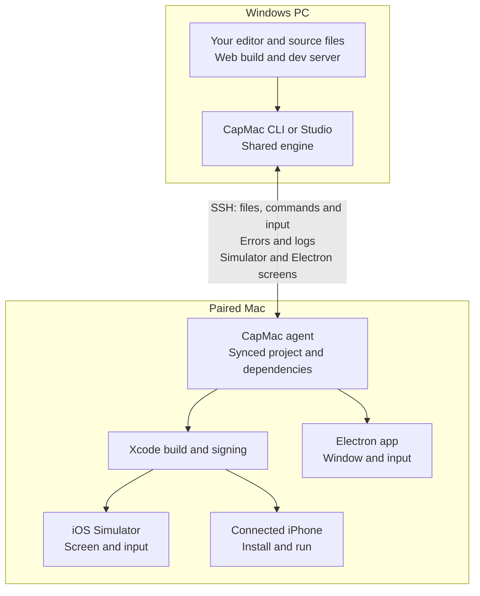

<div align="center">

# CapMac

**Build Capacitor iOS apps from Windows with your own Mac**

Keep your editor, web build and dev server on Windows.
CapMac builds your Capacitor or Ionic app with Xcode on a paired Mac and brings the simulator screen, build errors and app logs back to your PC.

Run on iOS simulators or connected iPhones, export signed builds, and run Electron apps on the Mac desktop through the same CLI or Windows app.

**Your own Mac · SSH connection · CLI and CapMac Studio**

[Quick start](#quick-start) | [Download Studio](https://github.com/dotnetdreamer/capmac/releases/latest) | [Why CapMac](#why-capmac)

https://github.com/user-attachments/assets/d55fac9f-92fc-4e6e-953a-574a824a5ecb

</div>

[CapMac Studio](#capmac-studio) | [Capacitor and Ionic commands](#keep-your-capacitor-and-ionic-commands) | [Commands](#commands) | [Electron apps](#electron-apps) | [AI coding agents](#ai-coding-agents) | [Remote access](#away-from-the-macs-network) | [Development](#developing-capmac)

## Why CapMac

An iOS build needs a Mac, but that does not have to move your daily work off Windows.
CapMac handles the file sync, Xcode build and app launch, then brings the result back to the machine where you wrote the code.

| What you need | What CapMac does |
| --- | --- |
| Test native iOS behavior | Builds and runs your app on the Mac's iOS simulators or connected iPhones |
| See changes as you save | Uses your Windows dev server for web live reload and rebuilds when native code changes |
| Work through errors in your editor | Maps Xcode and Swift errors to Windows file paths and streams the app's console back to your PC |
| Use the simulator from Windows | Click, drag, scroll, type and take screenshots in Studio or your browser |
| See a real iPhone from Windows | Shows the screen of an iPhone plugged into the Mac live in Studio or your browser, with full-size screenshots |
| Keep familiar commands | Routes `npx cap run ios` and `ionic capacitor run ios -l` through your paired Mac |
| Avoid repeating build work | Transfers changed files and reuses native simulator output when only web assets changed |
| Prepare a release | Exports signed IPA files and uploads builds to App Store Connect for TestFlight |

Electron projects use the same pairing and commands to run on macOS, with the app's window and consoles available on Windows.
The [coding agent skill](#ai-coding-agents) lets your agent build, read logs and take screenshots through the CLI.

## How it works



Live reload uses an SSH tunnel to your Windows dev server.
Optional internet access uses your [signaling server](services/signal/deploy/README.md) to set up a direct WebRTC connection or relay fallback, with SSH protecting the session.

## Quick start

Use the CLI below, or [download CapMac Studio](https://github.com/dotnetdreamer/capmac/releases/latest) for a Windows desktop workspace.

On the Mac, install Xcode, open it once and install an iOS simulator runtime.
Enable **System Settings › General › Sharing › Remote Login** and keep the paired user logged in to the macOS desktop so simulators can run.

On Windows, install Node.js and npm, install your app's dependencies, then pair the Mac and run your app.

```powershell
npm install -g capmac
capmac pair
cd my-capacitor-app
capmac doctor
capmac run
```

Run app commands from the folder containing `capacitor.config.*`.
If the app has no iOS project yet, run `npx cap add ios` first.

`capmac pair` finds Macs on your network, or accepts an address such as `capmac pair user@mac.local`.
It asks you to trust the Mac's host key and uses your password once to install a dedicated SSH key, without storing the password.
Use `--identity <file>` for an existing SSH key or `--agent` for the Windows OpenSSH agent.

If Node.js is missing or too old on the Mac, pairing offers a private copy in `~/.capmac/runtime`.
CocoaPods is needed on the Mac only for projects that use it.

For live reload with the simulator in your browser:

```powershell
capmac dev --screen
```

The dev server runs on Windows through an SSH tunnel.
Web edits use the server's live reload, native edits trigger a rebuild, and the session reconnects if the connection drops.
Use `capmac dev --url http://localhost:5173` with a server you already started.

## CapMac Studio

Build, inspect logs and control the simulator in one Windows workspace.
Studio uses the same engine as the CLI.
Pair a Mac, add your project and press **Live** (F5) or **Run** (Ctrl+F5).

The workspace shows the build timeline, errors that open at the line in your editor, a searchable console with source and level filters, expandable JSON, and an interactive simulator.
Click, drag, scroll and type from Windows, or use Home, Lock and screenshot controls.
Pick a real iPhone as the target to see [its screen](#a-real-iphones-screen) in the same place.

Studio uses an H264 stream with a screenshot fallback.
If touch or keyboard input is unavailable, `capmac doctor --fix` can install AXe on the Mac.

From a [development checkout](#developing-capmac), `npm run desktop:build` creates x64 and arm64 installers and portable executables in `apps/desktop/release/<version>/`.
Builds are unsigned by default and updates stay off without a configured feed.
See [signing and updates](docs/signing-and-updates.md) for distribution setup.

Download installers and portable builds from [GitHub Releases](https://github.com/dotnetdreamer/capmac/releases/latest).
Maintainers can use **Actions → Release CapMac Studio** to build a dry run or publish a new version; see [releasing CapMac](docs/releases.md) for setup.

## Keep your Capacitor and Ionic commands

A global CapMac install enables takeover on your first command, and the packaged Studio app enables it on launch.
After pairing, open a new terminal or restart VS Code so its terminals pick up the setting.

```powershell
npx cap run ios
ionic capacitor run ios -l
```

| Command | What happens on the Mac |
| --- | --- |
| `npx cap run ios` | Uses your existing web build, builds with Xcode and launches the app |
| `npx cap run ios --list` | Lists the Mac's simulators and connected devices |
| `npx cap run ios -l` | Runs live reload through CapMac |
| `ionic capacitor run ios -l` | Tunnels the dev server Ionic starts on Windows |
| `npx cap open ios` or `ionic cap build ios` | Opens Xcode on the Mac's screen |
| `npx cap build ios` | Exports a signed IPA into `ios/App/output` |

`cap sync`, `cap copy`, `cap add` and Android commands still run on Windows.

Takeover adds a preload to your Windows user's `NODE_OPTIONS`.
Keep `%USERPROFILE%\.capmac\takeover.cjs` in place while it is enabled.
Use `capmac takeover off` to disable it, `capmac takeover on` to enable it, or `CAPMAC_TAKEOVER=0` for one command.
It is not enabled automatically by a temporary `npx capmac` copy or when `CI=true`.

## Commands

| Command | Use |
| --- | --- |
| `capmac run` | Build the web app, sync changes, build on the Mac, launch and stream the app's console |
| `capmac dev` | Live reload with automatic rebuilds for native changes |
| `capmac build` | Build without launching |
| `capmac build --ipa` | Export a signed IPA to `build/ios/` |
| `capmac build --upload` | Upload to App Store Connect for TestFlight |
| `capmac targets` | List simulators and connected devices |
| `capmac screen` | View and control a simulator in your browser (use `--stream compatible` for screenshots), or watch a plugged-in iPhone with `--device` |
| `capmac screenshot [file]` | Save a PNG of a simulator, or of a plugged-in iPhone with `--device`, and print its path |
| `capmac doctor --fix` | Check setup and repair what it can |
| `capmac info --files` | Show the detected project and exact sync list without connecting |
| `capmac apps` | List the apps in this folder and the selected app; use `capmac apps use <app>` to switch |
| `capmac exec -- <command>` | Run a command in the Mac's project copy |
| `capmac pull <path>` | Copy files back from the Mac |
| `capmac open` | Open the project in Xcode on the Mac |

Use `--target "<name or UDID>"` to select a simulator or device and `--mac <name>` to select a paired Mac.
For [projects with several apps](#one-folder-several-apps), use `--app ios` or `--app electron` to choose which app to run.
For scripts, `capmac run --no-logs` returns after launch, while `capmac run --for 20` captures the console for 20 seconds and then stops the app.

Build errors use Windows file paths so you can open them from your terminal.
Add `--os-logs` for NSLog and os_log, `--bridge` for Capacitor plugin traffic, or `--verbose` for full tool output.
Use `capmac --help` and `capmac <command> --help` for the remaining commands and options.

## Running on an iPhone

Connect or pair the iPhone with the Mac, tap **Trust**, enable **Developer Mode** and sign in under **Xcode › Settings › Accounts**.

```powershell
capmac run --device --team "<TEAM_ID>"
```

Signing needs the Mac's login keychain unlocked.
CapMac asks when needed, or you can unlock it before building with `capmac keychain`.
For device live reload, the iPhone must be able to reach the Mac's network address.

If Xcode reports an expired account session over SSH, supply an App Store Connect API key.

```powershell
capmac run --device --team "<TEAM_ID>" --api-key C:/keys/AuthKey_ABC123XYZ9.p8 --api-issuer "<ISSUER_ID>"
```

You can also set `ios.apiKey` in `capmac.json`, or use `CAPMAC_ASC_KEY_PATH`, `CAPMAC_ASC_KEY_ID` and `CAPMAC_ASC_ISSUER_ID`.
The same key works for IPA exports and uploads.

### A real iPhone's screen

Plug the iPhone into the Mac with a cable and unlock it.
Its screen shows up in Studio when the iPhone is the target, and in your browser with:

```powershell
capmac screen --device
capmac screenshot --device
```

The first time, the Mac asks whether **CapMac** may use the camera, because macOS treats an iPhone's screen as one.
Click **Allow** on the Mac once.
CapMac uses the same capture as QuickTime Player, through a small helper app that stays in the background on the Mac.
The iPhone's camera is never turned on, and its sound keeps playing on the iPhone.

The screen is view only for now: tap and type on the iPhone itself.
Over Wi-Fi alone, the iPhone runs your app but its screen can't be shown.

## Electron apps

CapMac runs plain Electron, electron-vite and Electron Forge apps, and Capacitor's Electron platform (`@capacitor-community/electron`), on the Mac's desktop.

```powershell
cd my-electron-app
capmac run
capmac dev
capmac screen --electron
```

`capmac run` syncs the app, installs its dependencies and Electron for the Mac, builds it and launches it, with the main process and page consoles in your terminal.
Objects in console lines read as they do in DevTools, like `{type: 'roll', value: 6}`.
`capmac dev` reloads the window when you save a page and restarts the app when main process code changes.
electron-vite and Forge projects reload through their own dev command.
In a Capacitor project, add `--electron` or `--target mac` to run the Electron platform, which loads your dev server in live reload.

`capmac screen --electron` shows the app's window in your browser, where you can click, scroll, type and use the app's menu shortcuts with Ctrl as ⌘.
`capmac screenshot --electron` saves a PNG of the window.
The Mac needs no Screen Recording or Accessibility permission for this.

The Mac encodes and streams the window as H.264 video.
A still window sends one frame when a viewer connects, then no more until it changes.
On slow connections, CapMac lowers the bitrate and skips frames to keep the stream responsive.
Electron versions older than 30 use screenshots, and `--stream compatible` selects them on newer versions too.
CapMac remembers this choice for both the CLI and Studio, where you can change it under **Settings › Screen stream**.

Someone may be using the Mac while you work, so the app opens behind their windows and never takes their keyboard.
DevTools and full screen wait until someone switches to the app on the Mac.
After a restart, the app comes back to the front only if someone was using it there.

The app's message boxes and file dialogs stay off the Mac's screen too.
They show over the app's window in Studio and `capmac screen --electron`, and in your terminal, where you answer them.
File dialogs browse the Mac's folders, starting in your project's copy on the Mac.
`capmac dialog` lists them and answers one from a script or an AI agent: `capmac dialog 2`, `capmac dialog Discard`, `capmac dialog "~/Documents/photo.png"` or `capmac dialog --cancel`.
Someone who switches to the app on the Mac gets the dialog there instead.

In Studio, Electron apps run on **Mac desktop (Electron)** in the target picker and show in a window pane with the Mac's title bar.
**Try a sample** on the home screen creates a small Electron app to start with.
Change how the app is found, built or started in `capmac.json`.

```json
{ "electron": { "dir": "electron", "build": "npm run build", "start": "npm start", "dev": "npm run dev" } }
```

## One folder, several apps

A folder can contain both a Capacitor iOS app and an Electron app for the Mac.
CapMac finds the apps by reading their files, without running them.
It also checks subfolders in a monorepo.

Studio asks which app to use if you haven't already chosen one.
Opening an app's folder, such as `electron/`, suggests that app.
Use the toolbar's app picker to switch later.
Targets follow your choice: simulators and connected iPhones for iOS, or the Mac desktop for Electron.

The CLI uses the same saved choice:

```powershell
capmac apps                 # the apps here, and the one CapMac uses
capmac apps use electron    # from now on, in the CLI and Studio
capmac run --app ios        # just this once
```

CapMac also recognizes Flutter, React Native, Expo, Tauri, .NET MAUI, Cordova, NativeScript and Xcode projects, but can't run them yet.

## Configuration

Place an optional `capmac.json` beside `capacitor.config.*`.

```json
{
  "host": "studio",
  "ios": { "target": "iPhone 16 Pro", "team": "ABCDE12345", "scheme": "App" },
  "web": { "build": "npm run build", "dev": "npm run dev" },
  "sync": { "exclude": ["docs/", "*.mp4"], "include": [".env.ios"] }
}
```

Sync respects `.gitignore`, includes the iOS project and built web assets, and skips `node_modules`, Android, Pods and build output.
In a Capacitor project, videos, design files, pictures over 2 MB and files over 100 MB stay on your PC unless they're in the web assets, a native platform or a local dependency: your PC builds the web app, so nothing on the Mac reads them.
`capmac info` lists what stays behind, and a `!path` line in `.capmacignore` sends one anyway.
Use `.capmacignore` or the sync settings above to change the file list.
Dependencies are installed on the Mac when needed, and simulator builds reuse native output when only web assets changed.

Monorepos sync from the lockfile root and run Capacitor in the app's subfolder.
The Mac's project copy lives under `~/.capmac/projects/`.

## Your Mac and your code

Builds run on a Mac you control, with Xcode and the Mac's keychain handling iOS signing.
CapMac syncs the files needed for the build to that Mac over SSH, and sends logs and simulator frames back through the connection.

Pairing checks the Mac's host key and installs a dedicated SSH key without storing your password.
You can also use an existing SSH key or the Windows OpenSSH agent.
Use `capmac info --files` to inspect what will be synced and `.capmacignore` to adjust it.

## Away from the Mac's network

Remote access needs your own [signaling server](services/signal/deploy/README.md).
Deploy it, then run these commands while your PC is on the Mac's network.

```powershell
capmac remote server wss://signal.example.com
capmac remote on
capmac remote status --test
```

CapMac then uses the local network when available and the internet otherwise, with WebRTC for a direct connection or your server's relay when needed.
SSH protects the connection on either route.

The Mac must stay awake and logged in.
`capmac remote set --keep-awake on` prevents idle sleep while remote access is on.
Use `capmac remote --help` for route, relay and access controls.

## AI coding agents

Give your coding agent access to the same build, run, log and screenshot commands you use.
Install the CapMac skill for agents such as Claude Code, Codex, GitHub Copilot or Cursor.

```powershell
capmac skill add
```

Choose the agents and whether to install for all projects or just this repository.
For an explicit choice, use `capmac skill add --agent claude-code,codex --global`.
Start a new agent session after installation.

Studio has the same setup under **Settings › Terminal commands › AI coding agents**.
`capmac skill` shows installed copies and `capmac skill show` prints the instructions for other agents.

## Troubleshooting

| Problem | Fix |
| --- | --- |
| SSH connection refused | Enable Remote Login on the Mac |
| Missing Node.js, Xcode setup or iOS runtime | Run `capmac doctor --fix` |
| Simulator will not boot | Log in to the Mac's desktop as the paired user |
| Signing reports `errSecInternalComponent` | Unlock the keychain with `capmac keychain` |
| Signing requires a development team | Pass `--team <TEAM_ID>` or set `ios.team` |
| Familiar Capacitor commands are still local | Check `capmac takeover` and open a new terminal or restart VS Code |
| Remote Mac is offline | Check that it is awake, logged in and has remote access enabled |
| No Electron window or page console | The app must start from source; a packaged app or a launcher that drops `NODE_OPTIONS` keeps CapMac out |
| A real iPhone's screen stays dark | Plug it into the Mac with a cable, unlock it and quit QuickTime Player if it shows the same iPhone |
| CapMac isn't allowed to see the iPhone's screen | On the Mac, turn on **CapMac** in **System Settings › Privacy & Security › Camera** |

## Developing CapMac

```powershell
npm install
npm run build
npm test
npm run typecheck
node bin/capmac.js --help
npm run desktop:dev
npm run desktop:test
npm run desktop:build
```

| Folder | Purpose |
| --- | --- |
| `packages/core` | Shared engine, protocol and Mac agent |
| `packages/cli` | CLI commands and browser simulator viewer |
| `apps/desktop` | CapMac Studio |
| `services/signal` | Signaling and relay server for remote access |
| `examples/hello-capacitor` | Minimal Vite and Capacitor app, with Capacitor's Electron platform |
| `examples/hello-electron` | Minimal Electron app |

See the [desktop design](docs/desktop-design.md) for architecture and simulator streaming details.

### Project intro video

The [Remotion intro](apps/intro/README.md) is an editable 68 second 1080p video showing the CLI, Studio and iOS workflow.

```powershell
npm ci --prefix apps/intro
npm run intro:studio
npm run intro:render
```

The render is saved to `out/capmac-intro-v4.mp4`.
