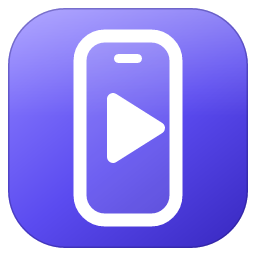
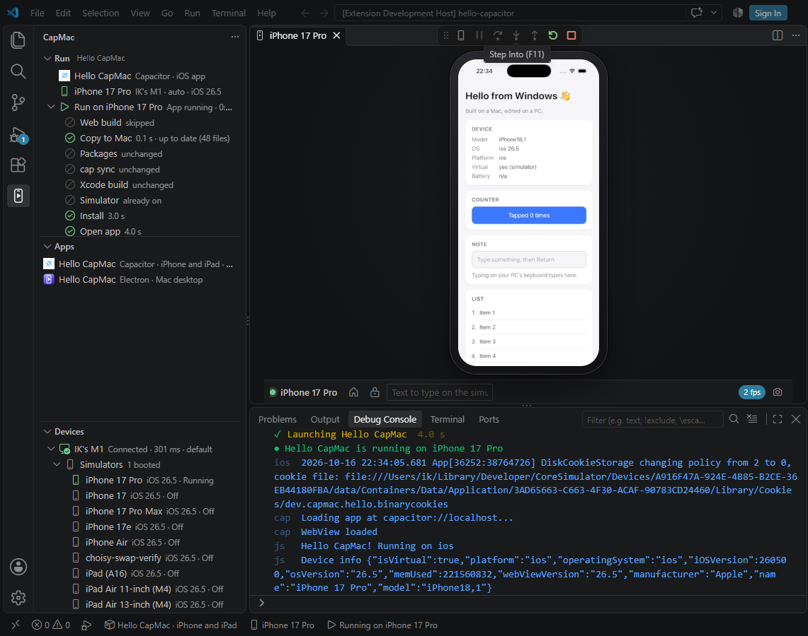
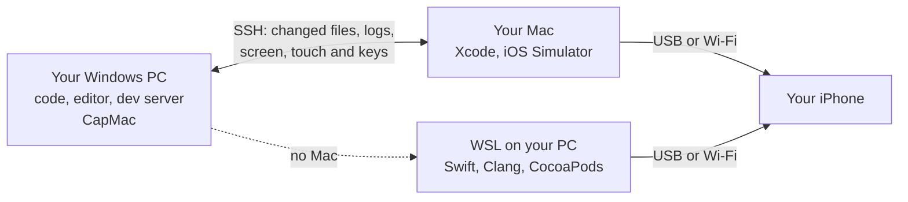

<div align="center">



# CapMac

### Build iPhone apps on Windows<br>With your Mac, or with no Mac at all

CapMac builds your app and runs it on the iOS Simulator or your own iPhone<br>You use it, read its logs and fix its errors without leaving your PC

**Capacitor · Ionic · Flutter · React Native · Electron**

[](https://github.com/dotnetdreamer/capmac/releases/latest)
[](https://marketplace.visualstudio.com/items?itemName=capmac.capmac-vscode)
[](LICENSE)
[](https://github.com/dotnetdreamer/capmac/releases/latest)

[**Download CapMac Studio**](https://github.com/dotnetdreamer/capmac/releases/latest) · [**CapMac for VS Code**](https://marketplace.visualstudio.com/items?itemName=capmac.capmac-vscode)

[Quick start](#quick-start) · [No Mac?](#no-mac-at-all) · [FAQ](#faq) · [Guide](docs/guide.md)

https://github.com/user-attachments/assets/cea942bc-a90b-4a7b-bb6c-0837361bfee8

</div>

## Why CapMac

Apple's tools for building iPhone apps only run on a Mac. If you work on a Windows PC, every usual way around that has a catch

- **Switch to a Mac**, and your editor, your tools and your habits stay behind
- **Rent a Mac in the cloud**, and you work through a remote desktop, pay every month, and keep your code on someone else's computer
- **Use a cloud build service**, and every native change waits for a build on someone else's computer

CapMac lets you stay on your PC. It uses a Mac you already have, even an old one in another room, or no Mac at all

## What you get

- **The simulator on your PC.** The iOS Simulator streams to your screen as smooth video, around 60 frames a second. Click, drag, scroll and type into it
- **Live reload.** Your dev server keeps running on Windows. Save a file and the app updates. Change native code and CapMac rebuilds it. Flutter's hot reload and React Native's Fast Refresh work too
- **VS Code, Studio or the terminal.** Run your app from the VS Code extension, the CapMac Studio app or the `capmac` command. They share one engine and one set of settings
- **Your own iPhone.** Run on an iPhone plugged into your Mac or your PC, or over Wi-Fi
- **No Mac? Still fine.** CapMac can build, sign and install your iPhone app from Windows alone. [See how](#no-mac-at-all)
- **Errors you can click.** Xcode, Swift and Dart errors point at the files on your PC. The app's console comes back with search and filters
- **Your usual commands.** `npx cap run ios` and `ionic cap run ios -l` work in any Windows terminal. CapMac runs them on your Mac
- **Mac and Windows apps too.** Run the Mac and Windows versions of a Flutter or React Native app, or an Electron app on the Mac, with its window on your PC
- **Ready to ship.** Export a signed IPA, or send a build to TestFlight from your Mac
- **Built for AI agents.** Claude Code, Codex, GitHub Copilot, Cursor, Gemini CLI and ten more can build, run, read the logs and take screenshots through CapMac

## Works with

| | iOS Simulator | iPhone | Mac app | Windows app | iPhone, no Mac |
| --- | :---: | :---: | :---: | :---: | :---: |
| **Capacitor and Ionic** | ✅ | ✅ | ✅ Electron | — | ✅ |
| **Flutter** | ✅ | ✅ | ✅ | ✅ | ✅ |
| **React Native** | ✅ | ✅ | ✅ | ✅ | ✅ |
| **Electron** | — | — | ✅ | — | — |

- Mac apps open on your Mac, and you use them from your PC
- Windows apps run on your PC, no Mac needed
- Expo apps work too, on the simulator and iPhones
- Without a Mac, Flutter apps rebuild on save instead of hot reloading

## Quick start

**1. Get CapMac.** All three share one engine and one set of settings, so you can switch any time

- [**CapMac Studio**](https://github.com/dotnetdreamer/capmac/releases/latest), the Windows app, as an installer or a portable app
- [**CapMac for VS Code**](https://marketplace.visualstudio.com/items?itemName=capmac.capmac-vscode), from the VS Code Marketplace: search for **CapMac** in VS Code's Extensions view
- **The CLI:** `npm install -g capmac` (needs Node.js 20.10 or newer)

**2. Run your app with a Mac.** On the Mac, install Xcode, open it once and add an iOS simulator when it asks. In System Settings, open General, then Sharing, and turn on **Remote Login**. Stay logged in on the Mac, because the simulator runs on its desktop. Then, on your PC:

```powershell
capmac pair     # find your Mac and connect to it, once
cd my-app
capmac run      # build, open in the simulator, show the logs
capmac dev      # live reload as you save
```

**Or run it with no Mac** (experimental). You need WSL 2 (`wsl --install --no-distribution` adds it), an iPhone, and a paid Apple Developer Program membership

```powershell
cd my-app
capmac wsl setup     # tools, one Apple sign-in and signing, in one go
capmac backend wsl   # build this app on this PC from now on
capmac run           # build, sign and open it on your plugged-in iPhone
```

In CapMac Studio it's all buttons. Pair your Mac or pick **This PC (no Mac)**, add your app's folder, and press **Live** (F5) or **Run** (Ctrl+F5). **Try a sample** gives you a small app to start with

## Studio, CLI or VS Code

**CapMac Studio** keeps the whole loop in one window. You see every build step, a console that stays fast with hundreds of thousands of lines, errors that open at the right line in your editor, and your app's screen

**The CLI** does everything Studio does, in your terminal and your scripts. `capmac --help` shows it all

**CapMac for VS Code** works on the folder you have open. Every run is a debug session, the screen opens in a tab next to your code, and errors land in Problems

<p align="center"></p>

## No Mac at all

Apple's simulator only runs on macOS, but your iPhone doesn't care where its app was built. CapMac's no-Mac mode builds, signs and installs the app from Windows

- **No Linux to learn.** CapMac sets up its own Ubuntu in WSL and installs every tool in it. Your own WSL setup stays as it is
- **One Apple sign-in.** You sign in once on Apple's website. CapMac makes the certificate, App IDs and profiles, and downloads Xcode to take the iPhone SDK from it
- **USB or Wi-Fi.** Plug the iPhone in for the first run. After that, it works over Wi-Fi too
- **Live reload.** Capacitor apps reload as you save and React Native apps get Fast Refresh. Flutter apps rebuild and reopen

It's experimental, and it already runs a real Capacitor game with 20 plugins, Firebase and a home-screen widget. Not every Xcode feature has a Windows twin yet, so check the [limits](docs/wsl-ios.md#compatibility-limits) first

### How is that possible?

Xcode only runs on macOS, but each job it does for an iPhone build has an open-source twin

| Xcode's job | What CapMac uses instead |
| --- | --- |
| Compile Swift, Objective-C and C++ | [Swift](https://www.swift.org) and [Clang](https://clang.llvm.org) for Linux, with Apple's iPhone SDK |
| Link the app | LLVM's `ld64.lld`, plus a fix for the Objective-C method stubs it gets wrong in big apps |
| Fetch native packages | The real [CocoaPods](https://cocoapods.org) and Swift Package Manager, pinned by your lockfiles |
| Compile storyboards and asset catalogs | Open-source compilers from [omarchy-apple-dev](https://github.com/joshuaswarren/omarchy-apple-dev) |
| Sign the app | [zsign](https://github.com/zhlynn/zsign) |
| Install and open it on the iPhone | [pymobiledevice3](https://github.com/doronz88/pymobiledevice3) |
| Compile Flutter's Dart code | Dart's iPhone compiler, built from Dart's source because Google ships it only for Macs. It makes the same machine code |

Every step and every limit is in [iOS on Windows with no Mac](docs/wsl-ios.md)

## How it works



With a Mac, CapMac sends only the files that changed, builds with Xcode, and streams the simulator back as video. Your dev server stays on Windows, and the app reaches it through the same SSH connection. Without a Mac, all of this happens on your PC

## FAQ

**Is it free?**
Yes. CapMac is open source under the MIT license. Apple charges for its Developer Program, which you need to sign apps for an iPhone without a Mac

**Does my code go anywhere?**
Only to your own Mac, over SSH. Without a Mac, it stays on your PC. There's no CapMac account, no CapMac server and no telemetry. CapMac even turns off Flutter's analytics

**Can I use the iOS Simulator without a Mac?**
No. Apple's simulator only runs on macOS. Without a Mac, CapMac runs your app on a real iPhone instead

**Can I publish to the App Store?**
With a Mac, yes. `capmac build --upload` sends your app to App Store Connect for TestFlight. Without a Mac, CapMac makes development builds for your own iPhones

**Does CapMac include Apple's software?**
No. With a Mac, it uses the Mac's own Xcode. Without one, setup downloads Xcode from Apple with your Apple Account and uses only its iPhone SDK. Make sure your use fits Apple's terms

**Which Mac do I need?**
Any Mac that runs Xcode 16 or newer. It doesn't have to be nearby. [Remote access](docs/guide.md#away-from-the-macs-network) reaches it over the internet, through a small server you run yourself

**What does CapMac change on my PC?**
To make `npx cap run ios` work in every terminal, CapMac adds a small preload to your Windows user's `NODE_OPTIONS`. `capmac takeover off` removes it. Native builds work on a copy of your project

**What about Android?**
Android already builds on Windows, so CapMac leaves it alone. `cap sync`, `cap add` and Android commands still run on your PC

**Is the no-Mac mode ready for my app?**
It's experimental. It builds real apps, but some Xcode features have no Windows twin yet, such as Metal shaders and Core ML models. The [compatibility limits](docs/wsl-ios.md#compatibility-limits) list them all, and the Mac mode is always there

## Learn more

- [The CapMac guide](docs/guide.md): every framework, command, setting and fix
- [iOS on Windows with no Mac](docs/wsl-ios.md): setup, signing, Wi-Fi and limits
- [CapMac for VS Code](apps/vscode/README.md)
- [The remote access server](services/signal/deploy/README.md)
- [How CapMac works inside](docs/desktop-design.md)

## Contributing

Bug reports and pull requests are welcome. If CapMac can't build your app, an issue with the build output helps the most

```powershell
npm install
npm run build          # the CLI, then try: node bin/capmac.js --help
npm test
npm run typecheck
npm run desktop:dev    # CapMac Studio, restarting as you edit
npm run vscode:build   # CapMac for VS Code
```

| Folder | What's in it |
| --- | --- |
| `packages/core` | The engine everything shares, and the agent that runs on the Mac |
| `packages/cli` | The `capmac` command |
| `apps/desktop` | CapMac Studio |
| `apps/vscode` | CapMac for VS Code |
| `services/signal` | The server for remote access |
| `examples` | Sample Capacitor, Flutter, React Native and Electron apps |

If CapMac saved you from buying a Mac, a star helps other Windows developers find it

## Thanks

CapMac stands on great open-source work, including [pymobiledevice3](https://github.com/doronz88/pymobiledevice3), [zsign](https://github.com/zhlynn/zsign), [Swift](https://www.swift.org), [LLVM](https://llvm.org), [CocoaPods](https://cocoapods.org), [omarchy-apple-dev](https://github.com/joshuaswarren/omarchy-apple-dev), [@expo/apple-utils](https://www.npmjs.com/package/@expo/apple-utils), [ssh2](https://github.com/mscdex/ssh2) and [Electron](https://www.electronjs.org)

## License

[MIT](LICENSE)
