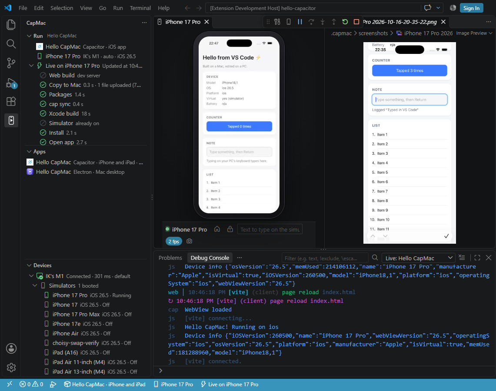
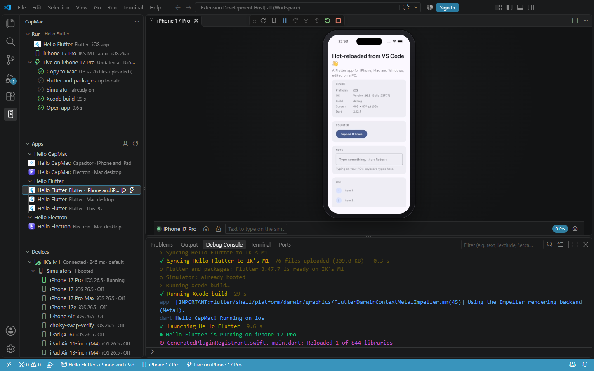
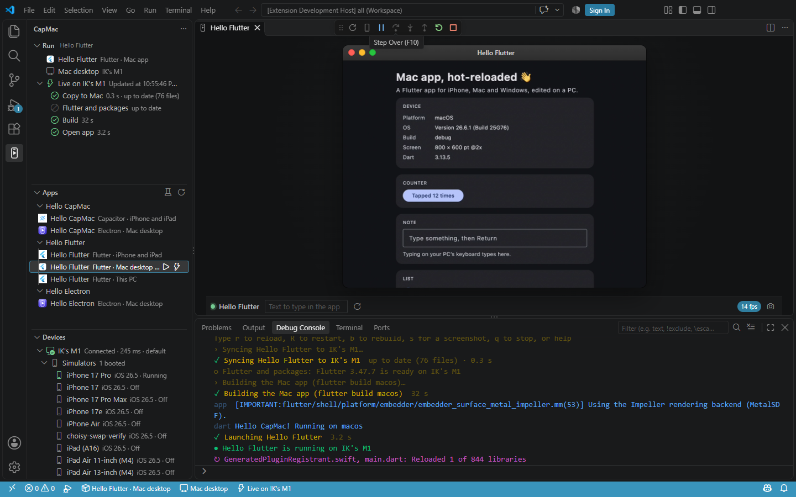
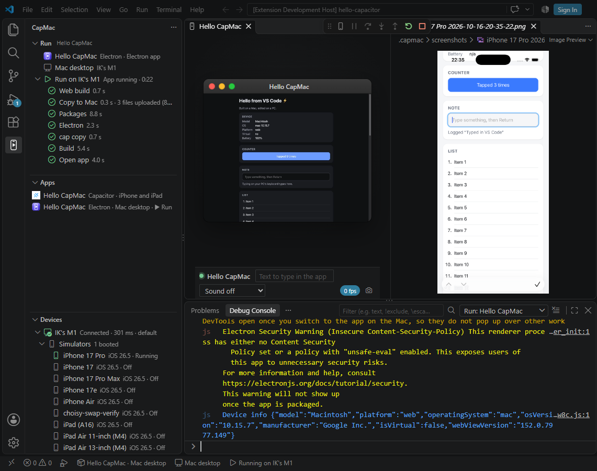
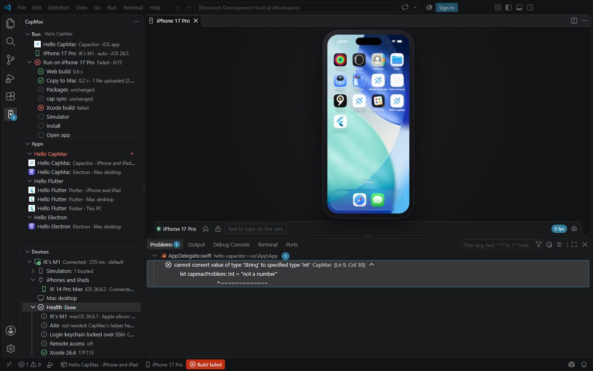
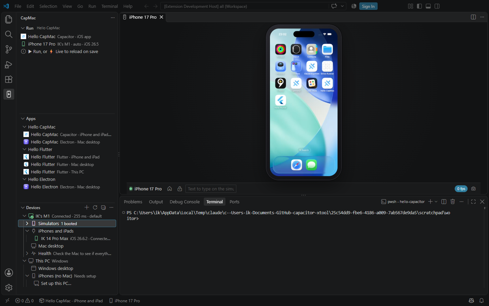
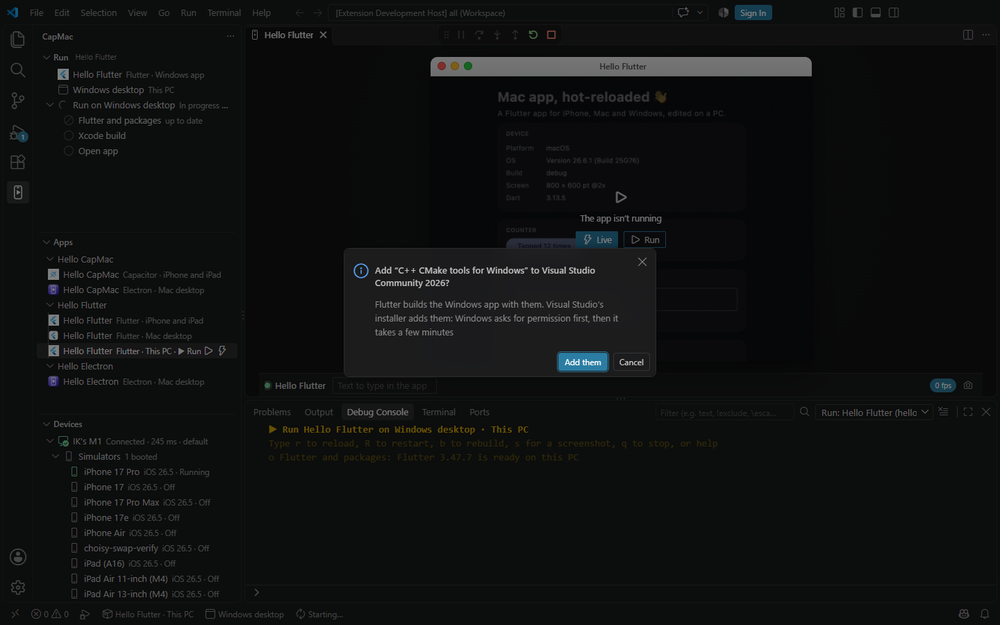

<div align="center">

# CapMac for VS Code

**Run your iPhone, Mac and Windows apps from VS Code on Windows**

Capacitor, Ionic, Flutter, React Native and Electron apps on iPhone simulators, real iPhones, the Mac's desktop and Windows.
With your own Mac, or with no Mac at all.

Open your project's folder: CapMac finds the app in it. Press **⚡ Live** and the app opens on the simulator,
its screen shows up in a tab beside your code, and every save updates it.

</div>


## What you get

| | |
| --- | --- |
| **Your project, found** | CapMac reads the open folder and finds its apps: a Capacitor app's iPhone and Electron apps, a Flutter or React Native app's iPhone, Mac and Windows apps, an Electron app. No project to pick, nothing to configure. |
| **Several projects at once** | Open a workspace of several folders, or a monorepo: CapMac lists the apps of each one, and works on the app of the file you edit until you pick one in the Apps view. Several apps can run at the same time, each in a debug session of its own. |
| **Run and live reload** | ▶ **Run** builds and opens the app. ⚡ **Live** keeps it running and updates it when you save: your dev server's live reload for Capacitor, hot reload for Flutter, Fast Refresh for React Native, window reloads for Electron. |
| **The screen, in a tab** | The simulator's screen, or your Mac app's window, streams into VS Code as smooth video. Click, drag, scroll and type on it, take full-size screenshots, and put it in a window of its own like a real simulator. |
| **A debug session like any other** | Every run is a VS Code debug session: Stop, Restart and Hot Reload on the debug toolbar, F5 to start, and the app's console (`console.log`, Dart's `print`, native logs) in the Debug Console with links to the line that logged. |
| **Errors where your code is** | Xcode, Swift and Dart errors from the Mac, and TypeScript and Vite errors from the web build, land in **Problems**, at the line in your files on this PC. |
| **Every step in sight** | The Run view shows each build step as it happens, with its time: copy to the Mac, packages, Xcode build, install, open. |
| **No Mac? This PC builds it** | CapMac can build and sign your iPhone app on this PC and put it on an iPhone plugged in with a cable (then over Wi-Fi). One setup does it all, one Apple sign-in included. |
| **AI agents run it too** | Copilot's agent mode (and any agent with VS Code's tools) can run your app, read its console and look at its screen. |

## Get started

1. **Choose where your app builds.** Pair your Mac with **CapMac: Pair a Mac**: CapMac finds it on your network (turn on *Remote Login* on the Mac first). No Mac? Run **CapMac: Set Up This PC for iPhones** instead.
2. **Open your app's folder.** The one with your `capacitor.config` file, your Flutter app's `pubspec.yaml`, or your React Native or Electron app's `package.json`. No app yet? **CapMac: Try a Sample App** copies one for you.
3. **Press ⚡ Live** in the CapMac view, on the status bar, or above your config file.

The **Get started** walkthrough (in VS Code's Welcome page) takes you through it.

## Live reload, hot reload and Fast Refresh



Save a file and the app updates. A Capacitor app reloads from your dev server on this PC; native changes (a plugin, Swift code, `capacitor.config`) rebuild the app by themselves.

A Capacitor app has two more ways to run, in the Run view's **…** menu and the command palette: **Run without Building the Web App** uses the web files you built last time, like `npx cap run`, and **Sync to the Mac** runs `cap sync` there without building or opening the app.



Flutter apps hot-reload when you save, keeping their state. Hot restart is **Ctrl+Shift+F5**, or `R` in the Debug Console.

React Native apps get their JavaScript from Metro on this PC, so a save shows in the app at once (Fast Refresh). `j` in the Debug Console, or the DevTools button on the debug toolbar, opens React Native DevTools, and **Run in Release Mode** runs the app as people get it.

## Mac and Windows apps



Electron apps and Flutter's and React Native's Mac apps open on the Mac's desktop, in the background, so they never take over the Mac of someone working at it. Their window shows up in VS Code with a Mac title bar: click, scroll and type on it, and answer the app's dialogs right there. A Flutter or React Native app's Windows app runs on this PC, in its own window.



## Errors in Problems



CapMac maps the Mac's file paths back to the files on this PC, so a click opens the line that failed. Errors from the web build on this PC (TypeScript, esbuild, Vite) go there too.

## Your Macs, simulators and iPhones



The **Devices** view shows each paired Mac with its simulators (start and stop them there), the iPhones and iPads plugged into it, and a health check with one-click fixes. **This PC** lists the Windows desktop and the iPhones plugged into this PC.

Pick where the app runs from the status bar, the Run view, or by clicking a simulator.

## Run and Debug

Every app is in the **Run and Debug** dropdown with no `launch.json`: *Live: Hello CapMac · iPhone 17 Pro*. Pick it once and **F5** starts it. In a `launch.json`:

```jsonc
{
  "type": "capmac",
  "request": "launch",
  "name": "CapMac: Live",
  "mode": "live",           // or "run"
  "target": "iPhone 17 Pro" // optional: a simulator or iPhone, by name or UDID
}
```

Other options: `app` (`ios`, `electron`, or a Flutter or React Native app's `macos` or `windows`), `mac`, `backend` (`mac` or `wsl` for this PC), `webBuild`, `clean`, `configuration` (`Release` for a React Native release run), `flutterMode` (`debug`, `profile`, `release`) and `screen`.

In the Debug Console, type:

| | |
| --- | --- |
| `r` | Reload (Flutter: hot reload, React Native: reload the JavaScript, Electron: reload the windows) |
| `R` | Restart the app (Flutter: hot restart) |
| `j` | Open React Native DevTools |
| `b` | Rebuild the native app and restart it |
| `s` | Save a screenshot and open it |
| `o` | Show the screen |
| `q` | Stop |

## AI agents

CapMac gives agents in VS Code five tools:

| Tool | What the agent can do |
| --- | --- |
| `#capmacStatus` | See the apps, where they run, and how the last run went, with its build errors |
| `#capmacRun` | Build and run the app (you confirm first) |
| `#capmacScreenshot` | Look at the app's screen |
| `#capmacLogs` | Read the app's console |
| `#capmacStop` | Stop it |

Try: *"Run my app, open the settings screen and tell me if anything looks broken."*

The `capmac` command is also in VS Code's terminals (unless you installed it already), for agents that work in a terminal and for your own scripts.

## Building without a Mac



**CapMac: Set Up This PC for iPhones** installs the build tools, signs in to Apple once (in your browser), sets up signing and gets the iPhone SDK. Then pick an iPhone plugged into this PC as where the app runs. Setup can stop and continue later; **CapMac: Check This PC** shows what's in place.

When something is missing (Visual Studio's C++ tools for a Windows app, Flutter on the Mac), CapMac says so and offers to add it.

## Settings

| Setting | |
| --- | --- |
| `capmac.screen.openOnRun` | Open the live screen when a run starts: `auto` (simulators and Mac apps), `always` or `never` |
| `capmac.screen.location` | `beside` the code, in the `active` editor group, or in a `window` of its own |
| `capmac.screen.deviceFrame` | A phone outline around simulators, a title bar on Mac app windows |
| `capmac.console.buildSteps` | Each build step in the Debug Console |
| `capmac.console.bridge` | Capacitor's bridge messages in the Debug Console |
| `capmac.osLogs` | The iPhone's system logs next to your app's console |
| `capmac.verbose` | Every line the build tools print |
| `capmac.codeLens` | Run and Live above `capacitor.config`, `pubspec.yaml`, `metro.config`, `app.json` and `capmac.json` |
| `capmac.terminal.capmacCommand` | The `capmac` command in VS Code's terminals |

The screen stream (smooth video, or compatible pictures), your paired Macs and each project's choices (its app, where it builds) are shared with the `capmac` command and CapMac Studio.

## Requirements

- Windows 10 or 11 and VS Code 1.100 or later
- Node.js 20 or later on this PC, for your web build and dev server
- **With a Mac:** a Mac with Xcode and *Remote Login* on, on your network (or reachable from anywhere with CapMac's remote access)
- **With no Mac:** WSL, an Apple developer account and an iPhone with a cable; setup gets the rest

## Privacy

CapMac talks to your Mac over SSH with a key it makes on this PC. Passwords are asked when needed and never saved. Nothing goes to a CapMac server: remote access, when you turn it on, uses a signaling server you run yourself.
